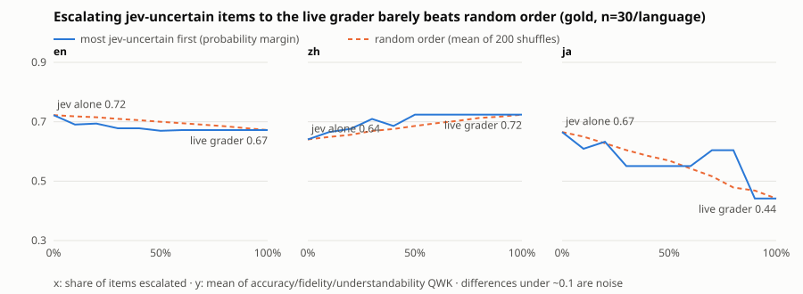

# Track C — Cascades: decision model as router, cheap LLM as second stage (DT grading)

**Date:** 2026-11-14 · **OpenRouter spend: $0.0665** of a $0.55 budget (1,308 logged calls, all priced from `usage.cost`) · no DB writes, no production code changed, nothing outside this directory touched.

## 1. Bottom line

1. **Using jev as the router does not pay.** One jev sentence call (the September 9-question request) costs $0.00008–0.00015. One qwen3.7-flash or deepseek-v4.1-flash call on the same sentence costs about $0.00002. The router is 4–8× more expensive than the stage it is supposed to protect, so every jev-first cascade costs more than sending every changed sentence straight to the cheap model.
2. **A cheap generative model on the changed sentences alone was the best frozen pipeline on gold**: pooled over the three languages (n=90) mean QWK .828 versus jev alone .761 and the recorded live grader .667, at $0.00008 per item, with an explanation on every error. The gain over jev (+.07, CI −.03 to +.18) is inside the noise; the gain over the live grader (+.18, CI +.02 to +.38) is not.
3. **Both true cascades, as frozen on silver, did not beat jev alone on gold** (C1 .651, C2 .616 pooled, versus jev .761; differences are within noise). In English they were clearly worse in point estimate (.50 and .48 versus .72). This is a negative result.
4. **Missed minor errors can be recovered, but only by sending most changed sentences to stage 2.** jev's probabilities for the errors it misses sit at the same level as its probabilities for clean sentences (Chinese silver: many missed errors at 0.04–0.15, clean sentences at 0.02–0.06), so there is no useful "uncertain band". Chinese minor recall goes from .11 to .89 only when 100% of changed sentences are escalated; Japanese .14 → .86 at 71%; English .75 → .92 at 74%.
5. **Escalating jev-uncertain items to the live grader does not help.** In English and Japanese the recorded live grader scores below jev on this gold set, so more escalation lowers QWK. In Chinese it raises QWK from .64 to .72, but ordering by jev uncertainty is no better than escalating at random, and the cheap cascade reaches the same level for 1/55 of the cost.
6. **The choice of cheap model mattered more than the architecture, and silver did not predict it.** qwen was best on silver and worst on English gold; deepseek and haiku were the reverse. At n≈30 per language I cannot reliably pick between cheap models.

Differences below about .1 QWK per language are noise at n=30 with ~70% clean items. Most per-language intervals span ±.2–.4.

## 2. What was tested

All pipelines end in the same place: a list of errors (type + severity) per item, turned into accuracy / fidelity / understandability bands by the live scoring code (`services/dual_translation/scoring.py`, offline pinned config), exactly as in the September jev experiment. Sentences that are byte-identical to the reference are marked clean without any call (as in September); "changed sentence" below means a non-identical sentence pair.

| | Architecture | Stage 1 | Stage 2 |
|---|---|---|---|
| ref | **jev alone** | September frozen config, cached responses | — |
| ref | **live grader** | recorded per-item outputs from `data/eval/dt_v6_gate_2026-10-08` (arm A on gold, arm C on silver); not re-run | — |
| ref | **cheap LLM alone** | — | one generative call per changed sentence: error list with type, severity and a ≤20-word explanation |
| **C1** | jev gate → LLM | jev on every changed sentence; escalate if its strongest signal (error probability or any narrow probe) ≥ gate | the same generative call, only on escalated sentences; others are clean |
| **C2** | inverse: LLM recall pass → jev verify | one generative call per item (whole passage) listing every error | each claimed error is checked by jev: either the September per-sentence signal, or a new claim-specific yes/no + severity question (323 new jev calls) |
| **C3** | uncertainty escalation | jev alone, or frozen C1 | items ranked by uncertainty are replaced by the recorded live-grader result |

Stage-2 models (OpenRouter list prices per million tokens, in/out): `qwen/qwen3.7-flash` ($0.03 / $0.13), `deepseek/deepseek-v4.1-flash` ($0.051 / $0.203), and `anthropic/claude-haiku-5.5` ($0.10 / $0.50) as a stronger option for the per-sentence call only. Reasoning was disabled; `max_tokens` 350 (sentence) / 600 (item). The prompt gives the v5 error types for that language with each type's default severity as a prior, plus the September severity definitions. Explanations are requested in English.

Severity options tried in the grid: the LLM's own severity; the taxonomy default for the LLM's error type (kept at critical if the LLM said critical) — "prior"; or jev's severity.

**Tuning and freezing.** Everything was chosen on silver (101 items) by 5-fold CV of the mean of the three QWKs. The rule, fixed before any gold stage-2 call: among configs within .02 of the best CV score, take the cheapest. `frozen_pre_gold_snapshot.json` is the frozen file as written before the gold calls. Gold was then scored once. Anything labelled *post-hoc* was computed after seeing gold and is descriptive only.

Frozen configs:

| L2 | cheap LLM alone | C1 | C2 |
|---|---|---|---|
| en | deepseek, prior severity | qwen, gate .3, jev severity | qwen, no verifier, prior severity |
| zh | haiku, prior severity | deepseek, gate 0 (every changed sentence), jev severity | qwen, claim verifier τ=.3, prior severity |
| ja | deepseek, LLM severity | deepseek, gate .2, jev severity | qwen, no verifier, prior severity |

In en and ja the selection rule dropped the jev verifier from C2 because it added cost without improving silver QWK. A "verifier forced on" row is reported so its effect is visible.

## 3. Gold results (frozen configs, n=30 per language)

P / R are at changed-sentence level (a sentence is flagged or not), the same unit as the September report. "minor R" is recall on sentences whose worst gold error is minor. "sev exact" compares the worst predicted severity with the worst gold severity on correctly flagged sentences. Latency for the live grader is approximate (from the gate report's wall times), not measured per item.

| L2 | pipeline (silver-frozen config) | acc | fid | und | mean | P | R | minor R | sev exact | subtype | changed sentences to stage 2 | $/item | latency p50 / p95 (s) |
|---|---|---|---|---|---|---|---|---|---|---|---|---|---|
| en | jev alone (Sept frozen) | 0.956 | 0.487 | 0.724 | **0.722** | 0.95 | 0.80 | 0.75 | 0.75 | 0.95 | 0% | 0.000097 | 0.28 / 0.34 |
| en | live grader (recorded 2026-10-08) | 0.828 | 0.561 | 0.627 | **0.672** | 0.96 | 0.92 | 0.83 | 0.48 | 0.87 | 100% | 0.001537 | 4.00 / 4.00 |
| en | cheap LLM alone, per changed sentence — model=deepseek, sev=prior | 0.977 | 0.575 | 0.750 | **0.767** | 0.96 | 0.96 | 0.92 | 0.83 | 0.83 | 100% | 0.000020 | 1.92 / 2.76 |
| en | C1 jev gate → LLM — model=qwen, gate=0.3, combine=llm, sev=jev | 0.388 | 0.383 | 0.724 | **0.498** | 0.96 | 0.96 | 0.92 | 0.71 | 0.71 | 74% | 0.000112 | 1.78 / 2.46 |
| en | C2 LLM recall pass → (jev verify) — model=qwen, verify=none, tau_v=0.0, sev=prior | 0.410 | 0.355 | 0.672 | **0.479** | 0.92 | 0.96 | 0.92 | 0.79 | 0.62 | 74% | 0.000020 | 1.62 / 2.17 |
| en | C2 with jev verifier forced on — model=qwen, verify=claim, tau_v=0.03, sev=prior | 0.410 | 0.355 | 0.672 | **0.479** | 0.92 | 0.96 | 0.92 | 0.79 | 0.62 | 74% | 0.000044 | 1.92 / 2.54 |
| zh | jev alone (Sept frozen) | 0.412 | 0.773 | 0.737 | **0.640** | 1.00 | 0.52 | 0.11 | 0.75 | 0.75 | 0% | 0.000134 | 0.28 / 0.64 |
| zh | live grader (recorded 2026-10-08) | 0.683 | 0.794 | 0.695 | **0.724** | 0.95 | 0.87 | 0.89 | 0.65 | 0.85 | 100% | 0.008390 | 70.00 / 70.00 |
| zh | cheap LLM alone, per changed sentence — model=haiku, sev=prior | 0.683 | 0.920 | 1.000 | **0.868** | 0.79 | 1.00 | 1.00 | 0.87 | 0.78 | 100% | 0.000198 | 1.04 / 1.26 |
| zh | C1 jev gate → LLM — model=deepseek, gate=0.0, combine=llm, sev=jev | 0.561 | 0.842 | 0.797 | **0.733** | 0.96 | 0.96 | 0.89 | 0.77 | 0.82 | 100% | 0.000153 | 2.51 / 4.80 |
| zh | C2 LLM recall pass → (jev verify) — model=qwen, verify=claim, tau_v=0.3, sev=prior | 0.386 | 0.706 | 0.597 | **0.563** | 1.00 | 0.83 | 0.67 | 0.68 | 0.74 | 59% | 0.000062 | 1.97 / 2.36 |
| zh | C2 with jev verifier forced on — model=qwen, verify=claim, tau_v=0.3, sev=prior | 0.386 | 0.706 | 0.597 | **0.563** | 1.00 | 0.83 | 0.67 | 0.68 | 0.74 | 59% | 0.000062 | 1.97 / 2.36 |
| ja | jev alone (Sept frozen) | 0.455 | 0.830 | 0.712 | **0.665** | 1.00 | 0.50 | 0.14 | 0.54 | 0.69 | 0% | 0.000176 | 0.28 / 0.36 |
| ja | live grader (recorded 2026-10-08) | 0.149 | 0.475 | 0.701 | **0.441** | 1.00 | 0.85 | 0.43 | 0.77 | 0.86 | 100% | 0.012140 | 108.00 / 108.00 |
| ja | cheap LLM alone, per changed sentence — model=deepseek, sev=llm | 0.851 | 0.818 | 0.728 | **0.799** | 1.00 | 0.96 | 1.00 | 0.80 | 0.84 | 100% | 0.000020 | 1.88 / 3.64 |
| ja | C1 jev gate → LLM — model=deepseek, gate=0.2, combine=llm, sev=jev | 0.683 | 0.849 | 0.694 | **0.742** | 1.00 | 0.92 | 0.86 | 0.67 | 0.83 | 71% | 0.000191 | 1.97 / 3.91 |
| ja | C2 LLM recall pass → (jev verify) — model=qwen, verify=none, tau_v=0.0, sev=prior | 0.923 | 0.814 | 0.676 | **0.804** | 0.93 | 0.96 | 0.86 | 0.76 | 0.72 | 77% | 0.000025 | 1.70 / 2.74 |
| ja | C2 with jev verifier forced on — model=qwen, verify=claim, tau_v=0.3, sev=prior | 0.923 | 0.814 | 0.676 | **0.804** | 0.92 | 0.92 | 0.71 | 0.75 | 0.75 | 74% | 0.000066 | 2.01 / 3.17 |

The live-grader figures here are recomputed from the recorded 2026-10-08 per-item outputs, so they differ from the July numbers quoted in the brief (for example en accuracy .828 here versus .778 in July; ja accuracy .149 versus .412). The recorded costs are also lower than the "200–400× jev" figure: $0.0015 (en), $0.0084 (zh), $0.0121 (ja) per item, which is 16×, 63× and 69× jev.

### Pooled over languages (n=90)

| pipeline (per-language frozen configs, pooled n=90) | acc | fid | und | mean QWK [95% CI] | Δ vs jev alone [95% CI] | Δ vs live [95% CI] | $/item |
|---|---|---|---|---|---|---|---|
| jev_alone | 0.797 | 0.764 | 0.723 | 0.761 [0.59, 0.86] | +0.000 [+0.00, +0.00] | +0.107 [-0.02, +0.30] | 0.000136 |
| live_grader_recorded | 0.703 | 0.629 | 0.669 | 0.667 [0.40, 0.80] | -0.107 [-0.30, +0.02] | +0.000 [+0.00, +0.00] | 0.007356 |
| llm_pair_alone | 0.900 | 0.791 | 0.793 | 0.828 [0.68, 0.92] | +0.071 [-0.03, +0.18] | +0.178 [+0.02, +0.38] | 0.000079 |
| c1_frozen | 0.493 | 0.730 | 0.731 | 0.651 [0.51, 0.79] | -0.100 [-0.25, +0.08] | +0.008 [-0.21, +0.29] | 0.000152 |
| c2_frozen | 0.527 | 0.665 | 0.657 | 0.616 [0.45, 0.78] | -0.135 [-0.30, +0.06] | -0.028 [-0.25, +0.26] | 0.000036 |
| c2_verified_frozen | 0.527 | 0.665 | 0.657 | 0.616 [0.45, 0.78] | -0.135 [-0.30, +0.06] | -0.028 [-0.25, +0.26] | 0.000057 |
| posthoc_c2_deepseek_noverify_prior | 0.914 | 0.751 | 0.742 | 0.802 [0.65, 0.90] | +0.047 [-0.05, +0.16] | +0.154 [-0.00, +0.35] | 0.000023 |
| posthoc_llm_pair_haiku_prior | 0.884 | 0.875 | 0.912 | 0.890 [0.77, 0.95] | +0.133 [+0.05, +0.24] | +0.241 [+0.10, +0.44] | 0.000196 |

The two *posthoc* rows were not frozen choices. They show what a single cross-language config would have scored and are candidates to confirm on fresh data, not results to rely on.

### Per-language paired differences

| L2 | comparison (mean QWK) | Δ | 95% CI (paired bootstrap) |
|---|---|---|---|
| en | c2_frozen − jev_alone | -0.210 | [-0.43, +0.07] |
| en | c2_frozen − live_grader_recorded | -0.148 | [-0.42, +0.28] |
| en | c1_frozen − jev_alone | -0.194 | [-0.40, +0.05] |
| en | llm_pair_alone − jev_alone | +0.056 | [-0.08, +0.24] |
| en | jev_alone − live_grader_recorded | +0.062 | [-0.06, +0.30] |
| zh | c2_frozen − jev_alone | -0.057 | [-0.28, +0.17] |
| zh | c2_frozen − live_grader_recorded | -0.138 | [-0.36, +0.08] |
| zh | c1_frozen − jev_alone | +0.119 | [-0.02, +0.55] |
| zh | llm_pair_alone − jev_alone | +0.257 | [+0.04, +0.67] |
| zh | jev_alone − live_grader_recorded | -0.081 | [-0.22, +0.06] |
| ja | c2_frozen − jev_alone | +0.152 | [-0.03, +0.32] |
| ja | c2_frozen − live_grader_recorded | +0.432 | [+0.08, +0.84] |
| ja | c1_frozen − jev_alone | +0.090 | [-0.04, +0.24] |
| ja | llm_pair_alone − jev_alone | +0.144 | [-0.10, +0.37] |
| ja | jev_alone − live_grader_recorded | +0.280 | [-0.13, +0.76] |

Only three per-language differences exclude zero: zh cheap-LLM-alone over jev, ja C2 over the live grader, and (pooled) cheap-LLM-alone over the live grader.

## 4. C1: cost versus quality for each escalation threshold

Model and severity rule are the frozen ones for that language; only the gate moves. "jev-flagged only" is the pure confirm-and-explain cascade: stage 2 sees only what jev already flagged, so recall cannot rise.

| L2 | gate (escalate if jev signal ≥) | changed sentences escalated | all sentences escalated | items with a stage-2 call | P | R | minor R | sev exact | mean QWK | $/item | latency p50 / p95 (s) |
|---|---|---|---|---|---|---|---|---|---|---|---|
| en | jev-flagged only | 60% | 17% | 57% | 0.95 | 0.80 | 0.75 | 0.75 | 0.498 | 0.000109 | 1.71 / 2.46 |
| en | 0.5 | 66% | 19% | 63% | 0.95 | 0.84 | 0.75 | 0.71 | 0.498 | 0.000110 | 1.74 / 2.46 |
| en | 0.3 **(frozen)** | 74% | 21% | 70% | 0.96 | 0.96 | 0.92 | 0.71 | 0.498 | 0.000112 | 1.78 / 2.46 |
| en | 0.2 | 74% | 21% | 70% | 0.96 | 0.96 | 0.92 | 0.71 | 0.498 | 0.000112 | 1.78 / 2.46 |
| en | 0.1 | 91% | 26% | 87% | 0.93 | 1.00 | 1.00 | 0.72 | 0.498 | 0.000114 | 1.81 / 2.46 |
| en | 0.05 | 97% | 28% | 93% | 0.93 | 1.00 | 1.00 | 0.72 | 0.498 | 0.000115 | 1.81 / 2.46 |
| en | 0.03 | 100% | 29% | 97% | 0.93 | 1.00 | 1.00 | 0.72 | 0.498 | 0.000116 | 1.81 / 2.46 |
| en | 0.0 | 100% | 29% | 97% | 0.93 | 1.00 | 1.00 | 0.72 | 0.498 | 0.000116 | 1.81 / 2.46 |
| zh | jev-flagged only | 38% | 11% | 37% | 1.00 | 0.52 | 0.11 | 0.75 | 0.714 | 0.000143 | 0.31 / 4.13 |
| zh | 0.5 | 38% | 11% | 37% | 1.00 | 0.52 | 0.11 | 0.75 | 0.714 | 0.000143 | 0.31 / 4.13 |
| zh | 0.3 | 47% | 13% | 43% | 1.00 | 0.65 | 0.33 | 0.73 | 0.714 | 0.000145 | 0.34 / 4.35 |
| zh | 0.2 | 50% | 14% | 47% | 1.00 | 0.70 | 0.44 | 0.69 | 0.690 | 0.000146 | 0.69 / 4.35 |
| zh | 0.1 | 69% | 20% | 67% | 0.95 | 0.78 | 0.44 | 0.72 | 0.733 | 0.000149 | 2.06 / 4.71 |
| zh | 0.05 | 97% | 28% | 93% | 0.95 | 0.91 | 0.78 | 0.76 | 0.733 | 0.000153 | 2.51 / 4.80 |
| zh | 0.03 | 100% | 29% | 97% | 0.96 | 0.96 | 0.89 | 0.77 | 0.733 | 0.000153 | 2.51 / 4.80 |
| zh | 0.0 **(frozen)** | 100% | 29% | 97% | 0.96 | 0.96 | 0.89 | 0.77 | 0.733 | 0.000153 | 2.51 / 4.80 |
| ja | jev-flagged only | 37% | 12% | 40% | 1.00 | 0.50 | 0.14 | 0.54 | 0.665 | 0.000184 | 0.34 / 3.64 |
| ja | 0.5 | 46% | 14% | 47% | 1.00 | 0.62 | 0.29 | 0.56 | 0.685 | 0.000186 | 0.50 / 3.64 |
| ja | 0.3 | 57% | 18% | 53% | 1.00 | 0.77 | 0.71 | 0.60 | 0.643 | 0.000188 | 1.79 / 3.91 |
| ja | 0.2 **(frozen)** | 71% | 22% | 67% | 1.00 | 0.92 | 0.86 | 0.67 | 0.742 | 0.000191 | 1.97 / 3.91 |
| ja | 0.1 | 89% | 27% | 83% | 1.00 | 0.96 | 1.00 | 0.68 | 0.742 | 0.000194 | 2.03 / 3.91 |
| ja | 0.05 | 100% | 31% | 97% | 1.00 | 0.96 | 1.00 | 0.68 | 0.742 | 0.000195 | 2.16 / 3.91 |
| ja | 0.03 | 100% | 31% | 97% | 1.00 | 0.96 | 1.00 | 0.68 | 0.742 | 0.000195 | 2.16 / 3.91 |
| ja | 0.0 | 100% | 31% | 97% | 1.00 | 0.96 | 1.00 | 0.68 | 0.742 | 0.000195 | 2.16 / 3.91 |

Reading it:

- **Recall recovery is real but not selective.** To get zh minor recall from .11 to .78 the gate has to drop to .05, which escalates 97% of changed sentences. There is no threshold that recovers the misses while skipping a meaningful share of stage-2 calls.
- **Stage-2 cost is a rounding error next to jev.** Moving from "flagged only" to "everything" adds $0.000007–0.000011 per item on top of $0.00010–0.00018 of jev. The cost column is flat because the router dominates it.
- **QWK barely moves with the gate** even when recall doubles, because the recovered errors are mostly minor and rarely change a band. In en it does not move at all: the two items that sink en accuracy are ones jev itself flags.
- The only thing the gate buys is **latency on items with no escalation** (~0.3 s instead of ~2 s). At the frozen gates that is 30% (en), 3% (zh) and 33% (ja) of items.

## 5. C2: what the jev verifier does

| L2 | verifier | τ_v | P | R | minor R | mean QWK | $/item |
|---|---|---|---|---|---|---|---|
| en | none | 0.0 | 0.92 | 0.96 | 0.92 | 0.479 | 0.000020 |
| en | claim-specific jev yes/no | 0.03 | 0.92 | 0.96 | 0.92 | 0.479 | 0.000044 |
| en | claim-specific jev yes/no | 0.05 | 0.92 | 0.96 | 0.92 | 0.479 | 0.000044 |
| en | claim-specific jev yes/no | 0.1 | 0.92 | 0.96 | 0.92 | 0.479 | 0.000044 |
| en | claim-specific jev yes/no | 0.2 | 0.96 | 0.92 | 0.83 | 0.479 | 0.000044 |
| en | claim-specific jev yes/no | 0.3 | 0.96 | 0.92 | 0.83 | 0.479 | 0.000044 |
| en | claim-specific jev yes/no | 0.5 | 1.00 | 0.80 | 0.83 | 0.438 | 0.000044 |
| en | Sept per-sentence jev signal | 0.03 | 0.92 | 0.96 | 0.92 | 0.479 | 0.000092 |
| en | Sept per-sentence jev signal | 0.05 | 0.92 | 0.96 | 0.92 | 0.479 | 0.000092 |
| en | Sept per-sentence jev signal | 0.1 | 0.92 | 0.96 | 0.92 | 0.479 | 0.000092 |
| en | Sept per-sentence jev signal | 0.2 | 0.96 | 0.96 | 0.92 | 0.479 | 0.000092 |
| en | Sept per-sentence jev signal | 0.3 | 0.96 | 0.96 | 0.92 | 0.479 | 0.000092 |
| en | Sept per-sentence jev signal | 0.5 | 0.95 | 0.84 | 0.75 | 0.479 | 0.000092 |
| zh | none | 0.0 | 0.88 | 0.91 | 0.89 | 0.563 | 0.000032 |
| zh | claim-specific jev yes/no | 0.03 | 0.88 | 0.91 | 0.89 | 0.563 | 0.000062 |
| zh | claim-specific jev yes/no | 0.05 | 0.88 | 0.91 | 0.89 | 0.563 | 0.000062 |
| zh | claim-specific jev yes/no | 0.1 | 0.88 | 0.91 | 0.89 | 0.563 | 0.000062 |
| zh | claim-specific jev yes/no | 0.2 | 0.88 | 0.91 | 0.89 | 0.563 | 0.000062 |
| zh | claim-specific jev yes/no | 0.3 | 1.00 | 0.83 | 0.67 | 0.563 | 0.000062 |
| zh | claim-specific jev yes/no | 0.5 | 1.00 | 0.74 | 0.67 | 0.518 | 0.000062 |
| zh | Sept per-sentence jev signal | 0.03 | 0.88 | 0.91 | 0.89 | 0.563 | 0.000133 |
| zh | Sept per-sentence jev signal | 0.05 | 0.87 | 0.87 | 0.78 | 0.563 | 0.000133 |
| zh | Sept per-sentence jev signal | 0.1 | 0.94 | 0.74 | 0.44 | 0.563 | 0.000133 |
| zh | Sept per-sentence jev signal | 0.2 | 1.00 | 0.61 | 0.33 | 0.518 | 0.000133 |
| zh | Sept per-sentence jev signal | 0.3 | 1.00 | 0.57 | 0.22 | 0.540 | 0.000133 |
| zh | Sept per-sentence jev signal | 0.5 | 1.00 | 0.43 | 0.00 | 0.522 | 0.000133 |
| ja | none | 0.0 | 0.93 | 0.96 | 0.86 | 0.804 | 0.000025 |
| ja | claim-specific jev yes/no | 0.03 | 0.93 | 0.96 | 0.86 | 0.804 | 0.000066 |
| ja | claim-specific jev yes/no | 0.05 | 0.93 | 0.96 | 0.86 | 0.804 | 0.000066 |
| ja | claim-specific jev yes/no | 0.1 | 0.93 | 0.96 | 0.86 | 0.804 | 0.000066 |
| ja | claim-specific jev yes/no | 0.2 | 0.92 | 0.92 | 0.71 | 0.804 | 0.000066 |
| ja | claim-specific jev yes/no | 0.3 | 0.92 | 0.92 | 0.71 | 0.804 | 0.000066 |
| ja | claim-specific jev yes/no | 0.5 | 0.94 | 0.65 | 0.29 | 0.802 | 0.000066 |
| ja | Sept per-sentence jev signal | 0.03 | 0.93 | 0.96 | 0.86 | 0.804 | 0.000161 |
| ja | Sept per-sentence jev signal | 0.05 | 0.93 | 0.96 | 0.86 | 0.804 | 0.000161 |
| ja | Sept per-sentence jev signal | 0.1 | 0.96 | 0.96 | 0.86 | 0.804 | 0.000161 |
| ja | Sept per-sentence jev signal | 0.2 | 1.00 | 0.92 | 0.71 | 0.804 | 0.000161 |
| ja | Sept per-sentence jev signal | 0.3 | 1.00 | 0.73 | 0.57 | 0.711 | 0.000161 |
| ja | Sept per-sentence jev signal | 0.5 | 1.00 | 0.62 | 0.29 | 0.751 | 0.000161 |

The verifier behaves as a precision filter that costs recall, mostly minor recall. Chinese is the clearest case: at τ=.3 precision goes .88 → 1.00 and minor recall .89 → .67, with QWK unchanged. In no language did a verifier threshold raise gold QWK. The claim-specific question is cheaper and loses less recall than reusing the September per-sentence signal.

## 6. C3: escalation rate versus quality

Base = jev alone; items ordered by jev probability margin (closest to 0.5 first); escalated items take the recorded live-grader result and pay its recorded cost.

| L2 | items escalated | mean QWK, most-uncertain first | mean QWK, random order | acc / fid / und | $/item | latency p50 / p95 (s) |
|---|---|---|---|---|---|---|
| en | 0% | 0.722 | 0.722 | 0.96 / 0.49 / 0.72 | 0.00010 | 0.3 / 0.3 |
| en | 20% | 0.694 | 0.715 | 0.88 / 0.49 / 0.71 | 0.00040 | 0.3 / 4.3 |
| en | 40% | 0.678 | 0.705 | 0.88 / 0.53 / 0.63 | 0.00071 | 0.3 / 4.3 |
| en | 60% | 0.672 | 0.695 | 0.83 / 0.56 / 0.63 | 0.00102 | 4.2 / 4.3 |
| en | 80% | 0.672 | 0.685 | 0.83 / 0.56 / 0.63 | 0.00133 | 4.3 / 4.3 |
| en | 100% | 0.672 | 0.672 | 0.83 / 0.56 / 0.63 | 0.00163 | 4.3 / 4.3 |
| zh | 0% | 0.640 | 0.640 | 0.41 / 0.77 / 0.74 | 0.00013 | 0.3 / 0.6 |
| zh | 20% | 0.676 | 0.656 | 0.56 / 0.77 / 0.69 | 0.00181 | 0.3 / 70.3 |
| zh | 40% | 0.686 | 0.676 | 0.59 / 0.77 / 0.69 | 0.00349 | 0.3 / 70.3 |
| zh | 60% | 0.724 | 0.695 | 0.68 / 0.79 / 0.69 | 0.00517 | 70.2 / 70.3 |
| zh | 80% | 0.724 | 0.713 | 0.68 / 0.79 / 0.69 | 0.00685 | 70.3 / 70.6 |
| zh | 100% | 0.724 | 0.724 | 0.68 / 0.79 / 0.69 | 0.00852 | 70.3 / 70.6 |
| ja | 0% | 0.665 | 0.665 | 0.45 / 0.83 / 0.71 | 0.00018 | 0.3 / 0.4 |
| ja | 20% | 0.633 | 0.627 | 0.29 / 0.83 / 0.78 | 0.00260 | 0.3 / 108.3 |
| ja | 40% | 0.551 | 0.585 | 0.15 / 0.74 / 0.76 | 0.00503 | 0.3 / 108.3 |
| ja | 60% | 0.551 | 0.543 | 0.15 / 0.74 / 0.76 | 0.00746 | 108.3 / 108.3 |
| ja | 80% | 0.604 | 0.479 | 0.15 / 0.78 / 0.89 | 0.00989 | 108.3 / 108.3 |
| ja | 100% | 0.441 | 0.441 | 0.15 / 0.47 / 0.70 | 0.01232 | 108.3 / 108.4 |

Silver-frozen thresholds for each base and uncertainty score, applied to gold:

| L2 | base | uncertainty score | silver-frozen threshold → gold items escalated | gold mean QWK at that point | base alone | $/item |
|---|---|---|---|---|---|---|
| en | jev alone | margin | 43% | 0.678 | 0.722 | 0.00076 |
| en | jev alone | sig | 13% | 0.710 | 0.722 | 0.00030 |
| en | jev alone | disagree | 27% | 0.694 | 0.722 | 0.00051 |
| en | C1 frozen | margin | 7% | 0.458 | 0.498 | 0.00021 |
| en | C1 frozen | sig | 13% | 0.624 | 0.498 | 0.00032 |
| en | C1 frozen | disagree | 3% | 0.498 | 0.498 | 0.00016 |
| zh | jev alone | margin | 17% | 0.701 | 0.640 | 0.00153 |
| zh | jev alone | sig | 0% | 0.640 | 0.640 | 0.00013 |
| zh | jev alone | disagree | 50% | 0.724 | 0.640 | 0.00433 |
| zh | C1 frozen | margin | 0% | 0.733 | 0.733 | 0.00015 |
| zh | C1 frozen | sig | 0% | 0.733 | 0.733 | 0.00015 |
| zh | C1 frozen | disagree | 7% | 0.752 | 0.733 | 0.00071 |
| ja | jev alone | margin | 3% | 0.690 | 0.665 | 0.00058 |
| ja | jev alone | sig | 0% | 0.665 | 0.665 | 0.00018 |
| ja | jev alone | disagree | 0% | 0.665 | 0.665 | 0.00018 |
| ja | C1 frozen | margin | 3% | 0.766 | 0.742 | 0.00060 |
| ja | C1 frozen | sig | 0% | 0.742 | 0.742 | 0.00019 |
| ja | C1 frozen | disagree | 0% | 0.742 | 0.742 | 0.00019 |

("disagree" = jev and the cheap model disagree on whether a sentence has an error, or on its severity.) No frozen C3 point beats its base by more than noise, and the en and ja curves fall as escalation rises. The uncertainty-ordered curve tracks the random-order curve within about .05 almost everywhere. jev's misses are confident misses, so its margin does not find them.

## 7. Explanations

Every error from a generative stage came with an explanation. On gold, 93–100% were within 20 words except two frozen configs that ran longer (ja C2: 20 of 28 within the limit, mean 17 words; zh C2: 18 of 20). I read 27 of them against the gold error (9 per language; I am not a native-speaker judge): 24 were correct and usable, 3 were flawed — two Chinese ones gave a wrong reason (one named 着 as the fix where the reference has 了; one called a word-order error an "addition"), and one Japanese one used the wrong grammar term. All samples are in `explanation_samples.json`. No explanation quality metric was computed beyond length; this needs a native check before learner-facing use. Explanations were in English, not the learner's L1.

## 8. Why English cascades failed, and what that says about the data

The en C1/C2 collapse (accuracy QWK .39–.41 versus jev's .96) comes from **two items**. qwen detects "with it → without it" and rates it critical, but labels it `word_choice` instead of `preposition`. Error type decides which dimension is penalised, so fidelity drops to 1 and accuracy stays at 4 where gold has accuracy 1. deepseek labels it `preposition` and scores .98. jev's error-type choice was better than qwen's in English (95% versus 62–71% right).

Post-hoc, one config across all languages, silver and gold side by side:

| config (post-hoc, same for all languages) | silver en | silver zh | silver ja | gold en | gold zh | gold ja |
|---|---|---|---|---|---|---|
| jev: | 0.86 | 0.70 | 0.89 | 0.72 | 0.64 | 0.67 |
| live: | 0.70 | 0.69 | 0.51 | 0.67 | 0.72 | 0.44 |
| c2:qwen,none,0,prior | 0.91 | 0.64 | 0.99 | 0.48 | 0.56 | 0.80 |
| c2:qwen,none,0,llm | 0.88 | 0.66 | 0.83 | 0.38 | 0.56 | 0.72 |
| c2:deepseek,none,0,prior | 0.76 | 0.57 | 0.63 | 0.77 | 0.74 | 0.82 |
| c2:deepseek,none,0,llm | 0.71 | 0.53 | 0.62 | 0.75 | 0.77 | 0.79 |
| c2:deepseek,claim,0.3,prior | 0.79 | 0.57 | 0.62 | 0.77 | 0.74 | 0.82 |
| llm_pair:qwen,prior | 0.72 | 0.63 | 0.62 | 0.40 | 0.72 | 0.84 |
| llm_pair:deepseek,prior | 0.72 | 0.54 | 0.70 | 0.77 | 0.56 | 0.79 |
| llm_pair:haiku,prior | 0.45 | 0.73 | 0.67 | 0.79 | 0.87 | 0.91 |
| llm_pair:qwen,llm | 0.67 | 0.67 | 0.59 | 0.37 | 0.68 | 0.83 |
| llm_pair:deepseek,llm | 0.67 | 0.55 | 0.70 | 0.72 | 0.55 | 0.80 |
| llm_pair:haiku,llm | 0.52 | 0.75 | 0.69 | 0.75 | 0.82 | 0.95 |
| c1:deepseek,flag,llm,prior | 0.69 | 0.56 | 0.68 | 0.77 | 0.54 | 0.70 |
| c1:deepseek,0.1,llm,prior | 0.72 | 0.54 | 0.70 | 0.77 | 0.56 | 0.79 |

(Keys: `c2:<model>,<verifier>,<τ>,<severity>` is the item-level pass; `llm_pair:<model>,<severity>` is the per-sentence call; `c1:<model>,<gate>,llm,<severity>`.) The cheap models' rank order on silver is close to the reverse of their order on gold. Silver-based model selection was not reliable here.

## 9. Recommendation

| L2 | Recommended pipeline | Gold mean QWK (jev alone / live) | $/item | Latency p50 / p95 | Confidence |
|---|---|---|---|---|---|
| en | Keep **jev alone** for bands; if explanations are needed add one deepseek-class call per changed sentence (frozen "cheap LLM alone": .767). Do not use the qwen cascades. | .722 jev (.722 / .672) | $0.0001 jev; $0.00002 LLM | 0.3 / 0.3 s jev; 1.9 / 2.8 s LLM | Low: LLM-vs-jev gap is +.06, noise |
| zh | **Cheap LLM on every changed sentence, no jev gate.** Frozen C1 at gate 0 is this plus jev severity (.733); haiku alone scored .868 but with precision .79. | .733–.868 (.640 / .724) | $0.00015–0.0002 | 1.0–2.5 / 1.3–4.8 s | Medium-low: only haiku-alone over jev excludes zero |
| ja | **One item-level cheap-LLM call, taxonomy-prior severity, no verifier** (frozen C2). | .804 (.665 / .441) | $0.000025 | 1.7 / 2.7 s | Medium-low: +.15 over jev, CI −.03 to +.32 |

Across languages the practical design is the same: skip identical sentences for free, send the rest to one flash-class generative call that returns type, severity and explanation, and take severity from the taxonomy default unless the model says critical. Blended cost is **$0.00002–0.0002 per item** depending on model (about $0.00008 for the frozen mix), roughly 20–600× cheaper than the recorded live grader and no more expensive than jev. jev is worth keeping in two narrow roles: as the English band grader, where its error typing is strongest, and optionally as a claim verifier where precision matters more than catching minor slips.

Before acting on any of this, re-test the model choice (deepseek versus haiku versus qwen) on data that is neither this silver nor this gold.

## 10. Caveats

- **Seeded data makes detection easy for anything that sees the reference.** 70% of gold sentences are byte-identical to the reference, and 71–74% of the changed ones contain a planted error. Real learner translations will differ from the reference in almost every sentence, mostly acceptably. The escalation percentages, the costs per item (which benefit from the free identical-sentence skip) and the near-perfect LLM recall will all look worse on real submissions. Precision is the number most likely to fall.
- **n=30 per language, ~10 clean.** QWK moved by .4 in English because of two items. Treat per-language differences under ~.1 as noise and most others as suggestive.
- **Model selection on silver did not transfer** (§8). The frozen configs are honest but partly unlucky; the post-hoc rows are partly lucky.
- **Live grader not re-run.** Its numbers are from recorded October outputs; its latency is an estimate from wall times (en ≈4 s, zh ≈70 s, ja ≈108 s per item), so C3 latency figures are rough.
- **Latency for the cheap models is a single run** through the agent proxy at concurrency 4; stage latencies are added sequentially and calls within a stage are assumed parallel. Provider variance is not captured.
- **jev cost is the September 9-question request.** A one-question gate would be cheaper (perhaps a third), which still would not undercut a $0.00002 generative call.
- **Naturalness and range were not attempted**; nothing here changes the September finding on them.
- **Explanations were not validated by a native speaker** and were written in English.
- `jaconv` was pip-installed into the sandbox Python so the September harness could be imported; no repo file changed.
- The September silver sets reuse the gold passages for en and ja (different planted errors), so tuning saw the same source text as the test.

## 11. Spend

| Model | Calls | USD |
|---|---|---|
| qwen/qwen3.7-flash | 389 | 0.0096 |
| deepseek/deepseek-v4.1-flash | 389 | 0.0093 |
| anthropic/claude-haiku-5.5 | 207 | 0.0361 |
| typesafe/jev-1.13 (claim verifier) | 323 | 0.0115 |
| **Total** | **1,308** | **0.0665** |

Ledger: `costs.jsonl` (every call, tokens, USD from OpenRouter `usage.cost`). The guard in `common.py` refuses to send at ≥ $0.50 cumulative; it never fired. Cached September jev responses and recorded live-grader outputs cost nothing.

## 12. Files

- `common.py` — ledger, budget guard, response cache, OpenRouter calls · `stage2.py` — generative prompts and runners · `verify.py` — jev claim verifier · `lib.py`, `pipelines.py` — offline data join, pipeline simulators, metrics
- `tune.py` → `frozen.json` (silver only; `frozen_pre_gold_snapshot.json` is the pre-gold copy) · `evaluate.py` → `results.json`, `explanation_samples.json` · `pooled.py`, `posthoc.py` (merged into `results.json`) · `chart.py` → `escalation_curve.svg` · `make_tables.py` → `tables.md`
- `stage2/`, `verify/` — per-call outputs · `cache/` — raw responses keyed by request hash
